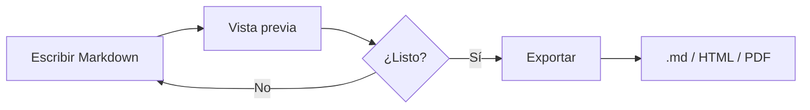

# Markdown Editor

Editor de Markdown **en el navegador**: vista previa en vivo, tablas, diagramas Mermaid, índice automático y exportación.

> Nada se guarda en el servidor ni en el navegador. Copia el texto o exporta antes de cerrar la pestaña.

## Índice

- [Markdown Editor](#markdown-editor)
  - [Características](#caracteristicas)
  - [Tabla de ejemplo](#tabla-de-ejemplo)
  - [Diagrama Mermaid](#diagrama-mermaid)
  - [Código](#codigo)

## Características

- Vista previa en tiempo real
- Tablas GFM
- Diagramas [Mermaid](https://mermaid.js.org/)
- Generación de índice (TOC)
- Exportar a `.md`, HTML y PDF


## Tabla de ejemplo


| Función      | Atajo / acción    | Estado |
| ------------ | ----------------- | ------ |
| Negrita      | Toolbar / `** **` | ✅      |
| Vista previa | Automática        | ✅      |
| Exportar PDF | Menú Exportar     | ✅      |


## Diagrama Mermaid




## Código

```ts
function greet(name: string) {
  return `Hola, ${name}!`
}
```

---

Usa **Insertar índice** en la barra de herramientas para generar un TOC a partir de los encabezados.

## Cómo ejecutarlo

Necesitas [Node.js](https://nodejs.org/) (versión 20 o superior).

```bash
git clone https://github.com/atp11/markdown-editor.git
cd markdown-editor
npm install
npm run dev
```

Abre en el navegador la URL que muestre Vite (por defecto `http://localhost:5173/markdown-editor/`).

Para generar la versión de producción:

```bash
npm run build
npm run preview
```

## Stack

- [Vite](https://vitejs.dev/) + TypeScript
- [CodeMirror 6](https://codemirror.net/)
- [markdown-it](https://github.com/markdown-it/markdown-it) + anclas
- [Mermaid](https://mermaid.js.org/)
- [DOMPurify](https://github.com/cure53/DOMPurify)


## Licencia

MIT — ver [LICENSE](LICENSE).